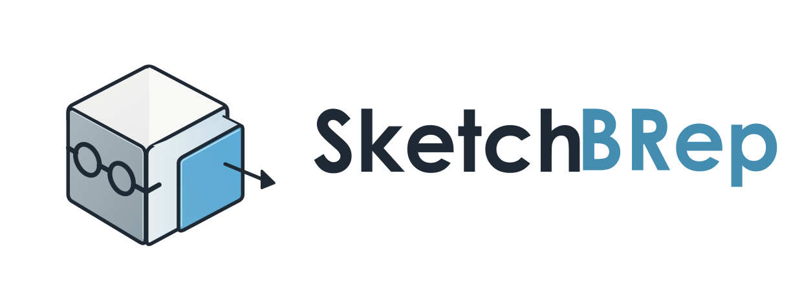

<p align="center"></p>

# SketchBRep（仮称）

建築設計向けハイブリッド 3D モデラー。
**操作は SketchUp、形状の本質は Rhino** — 面をクリックして押し出すだけの直接操作で、
内部では B-rep（Open CASCADE）を正規データとして保持します。

> 現在のステータス: **Phase 2（実用モデリング基礎）**


## できること

### Phase 0〜1

- 矩形・線（閉じると面）を描く。原点・端点・中点・エッジ上・面上スナップ、XYZ 軸推論、Shift/矢印キーでの方向ロック
- Push/Pull: 面 → ソリッド押出、ソリッド平面フェースの移動（Boolean + 面統合、失敗時ロールバック）
- 作図中の数値入力（`3000`, `4.5m`, `4000,6000`）と、直後の再入力による寸法変更
- パラメトリック再編集: 矩形の幅/奥行、押出距離、各 Push/Pull 距離を後から変更（レシピを再計算）
- Undo / Redo、ネイティブ保存（`.sbr`、原子的保存 + 検証）、STEP 入出力
- 表示メッシュと正規形状の分離（表示品質を変えても CAD 形状の精度は不変）

### Phase 2
- 移動 / 回転 / コピー: Ctrl でコピー、確定後に `x4`（同間隔で 4 個）・`/4`（4 等分）で直線・円形配列、数値の打ち直しで再編集
- オフセット: 平面プロファイルの輪郭を内外にオフセット（元の面は残し、新しい面を作成。距離は後から変更可）
- ソリッド演算（和・差・積）: **パラメトリック**。演算後も各入力の寸法（例: 開口の高さ）を変更すると結果が再計算される
- グループ / コンポーネント: 階層と配置の入れ子、定義を共有するインスタンス（定義の寸法を変えると全インスタンスが更新）、分解
- 推論の強化: 点から（追跡点を通る軸線）、軸と追跡点の交点、エッジに平行・垂直
- オブジェクト管理: 階層ツリー、タグ、色、位置の数値編集、表示/非表示
- STEP 連携の安定化: オブジェクト名・色を保持（XCAF）、グループ配置を反映、アセンブリ読込の平坦化
- **Rhino 3DM 入出力**（ファイルメニュー）: 正確な NURBS のポリサーフェスとして書き出し（名前・色・タグ→レイヤ）。3DM のサーフェス・ソリッドを読み込み（単位は mm に換算）

### 操作感（実機フィードバック反映）
- **面の上に描いて押し込むと穴・開口、引き出すと増築**: 壁に矩形を描いてプッシュ/プルで押し込むと開口になる（1 オブジェクトのまま、深さは後から変更可、Undo 1 回で元通り）

  
- 角やエッジから描き始めても、カーソル下の面の上に矩形・円・線が描ける（線は面から外れても同じ平面上）。背面に隠れた点・エッジにはスナップしない
- オフセット（F）はソリッドの面にも使える。面の内側に輪郭を作り、押し込めば枠やくぼみになる
- ツールごとのカーソルとツールバーのアイコン（鉛筆・矩形・プッシュ/プル・移動・回転・オフセット・曲線・回転体、オービット中は手のひら）
- プッシュ/プルや作図の後にオブジェクト全体が選択状態にならない
- 右パネルは「名前・選択・主要寸法」だけを表示し、タグ・色・位置・履歴・ID・入力の寸法などは折りたたみの「詳細」に格納

### AI 連携（MCP）
- メニュー「AI 連携 > 外部 AI からの操作を許可」（既定 OFF）を ON にすると、Claude Desktop / Claude Code などが `sbr_mcp` 経由で開いているモデルを操作できる（作成・押し出し・寸法変更・配列・ブーリアン・選択の読み取り・ビュー画像・シーン・寸法・注記・面の分割・輪郭の面化・断面・タグなど 46 ツール）
- AI の操作も GUI と同じコマンド基盤: 形状チェック・失敗時に何も変えない・Ctrl+Z で戻せる。まとめて実行（`batch`）は Undo 1 回分で、失敗すれば全部取り消し
- `sbr_cli` でアプリなしのスクリプト実行（JSON Lines）・ヘッドレス MCP。詳しくは [docs/06_ai_integration.md](docs/06_ai_integration.md)

## ビルド

依存: C++17 / CMake 3.21+ / Open CASCADE 7.6+ / Qt 6.2+ / nlohmann-json / GoogleTest

### Windows 11

**すぐ試す:** PR の CI（Actions）の成果物 `SketchBRep-windows-x64` をダウンロードして展開し、`SketchBRep.exe` を実行（インストール不要のポータブル版。実機で動作確認済み）。

**自分でビルド（vcpkg + Visual Studio 2022）:**

```powershell
git clone https://github.com/microsoft/vcpkg C:\vcpkg
C:\vcpkg\bootstrap-vcpkg.bat
C:\vcpkg\vcpkg install opencascade qtbase nlohmann-json gtest --triplet x64-windows

cmake -S . -B build -G "Visual Studio 17 2022" -A x64 `
      -DCMAKE_TOOLCHAIN_FILE=C:\vcpkg\scripts\buildsystems\vcpkg.cmake
cmake --build build --config Release
ctest --test-dir build -C Release --output-on-failure
build\src\app\Release\SketchBRep.exe
```

（vcpkg の opencascade 初回ビルドには時間がかかります。配布時は `windeployqt` で Qt DLL を同梱してください。）

### Linux（開発・CI 用。Ubuntu 24.04）

```bash
sudo apt install cmake ninja-build g++ libocct-*-dev libtbb-dev libfontconfig-dev qt6-base-dev libgl-dev \
                 nlohmann-json3-dev libgtest-dev xvfb
cmake -S . -B build -G Ninja && cmake --build build
xvfb-run -a ctest --test-dir build --output-on-failure   # GUI テストはディスプレイが必要
./build/src/app/SketchBRep
```

CMake オプション: `SBR_BUILD_APP`（GUI）, `SBR_BUILD_TESTS`, `SBR_BUILD_TOOLS`, `SBR_WITH_OPENNURBS`（3DM。構成時に openNURBS の固定コミットを取得）（すべて既定 ON）。オフラインでは `-DFETCHCONTENT_SOURCE_DIR_OPENNURBS=<openNURBS のソース>` を指定。
GUI なしでコアだけ検証する場合は `-DSBR_BUILD_APP=OFF`。

## 使い方

| 操作 | 内容 |
|---|---|
| ホイール / ホイールドラッグ / Shift+ホイールドラッグ | ズーム（カーソルの下の点へ 1 ノッチ一定の比率で寄る。近いほど細かい。表示 > ホイールズームの設定で調整）/ オービット（カーソル下の点が中心）/ パン |
| 選択ツール: クリック / ダブルクリック / トリプルクリック | 面・エッジ / ＋隣接（面→周囲のエッジ、エッジ→両側の面）/ オブジェクト全体（Shift で追加・解除）。グループ・コンポーネントはクリックで全体 |
| コンポーネントをダブルクリック / Esc | コンポーネント編集（その場で中を編集。終了するとすべてのコピーに反映、反映先の数を表示）/ 終了 |
| プロパティ「この配置だけ変更」/ 編集 > コンポーネントの配置 | 1 か所だけ寸法を変える（＊印。枠が太る伸縮ではなく寸法そのものを上書き）、独立、鏡像（その場で反転）、軸の変更（原点・赤軸をクリックで。どの配置も動かない）。詳細は [docs/14_components.md](docs/14_components.md) |
| 移動ツール（M）で Alt+クリック / 辺を選んで移動 | 角・辺・面をつかんで形を変える（箱の上の辺を上げて片流れ屋根、上の面をずらして平行六面体）。面は平らなまま。平らでなくなる動きは予告の段階で理由を出し、確定しても何も変えない。詳細は [docs/15_reshape.md](docs/15_reshape.md) |
| 線ツールで交差 | 線が交差して囲んだところは面になる（端点をつながなくてよい、# の 4 本目で中の四角が面に）。はみ出した線は残る |
| 消しゴム（E）で Shift+クリック / 編集 > 選んだ辺の線を隠す | 辺の線だけを隠す（面は分かれたまま。素材の塗り分け線など）。編集 > 隠した線をすべて表示 で戻す |
| グループをダブルクリック / Esc | グループ編集モード（中の要素を直接選択・編集、新しく描いた形はそのグループに入る。外側は半透明）/ 終了 |
| 何もない所からドラッグ | 囲み選択（左→右: 完全に囲んだ物、右→左: 触れた物。Shift で追加） |
| Esc（作図中） | 1 段階戻る（円弧の膨らみ → 終点の選び直し など）。もう一度で中止 |
| Delete | 選択を削除（ソリッドの面・エッジ単体は不可。単独の面・線はそのまま削除できる） |
| 何もない所をダブルクリック・中ボタンのダブルクリック | 選択対象へフォーカス（表示メニューで ON/OFF） |
| F2〜F7 / F8 / Shift+Z | 標準ビュー（アイソメ・平面・正面・右・背面・左）/ 透視⇔平行 / 全体表示 |
| Space / L / R / P | 選択 / 線 / 矩形 / プッシュ/プル |
| M / Q / F | 移動 / 回転 / オフセット（移動・回転中は Ctrl でコピー切替） |
| C | 円（中心 → 半径。面の上にも描ける。数値で半径、直後の再入力で変更） |
| W | 壁（平面上で点を順にクリック。数値で長さ、始点クリックで閉じる、ダブルクリック／入力なしの Enter で確定、Esc で 1 点戻す。1 区間 1 枚の壁、角は突き付け。厚さ・高さ・基準線（左／中心／右）は ツール > 壁の設定） |
| Shift+W | スラブ（床の角を順にクリック。数値で長さ、始点クリックか入力なしの Enter で閉じる。天端はクリックした高さ＝地面なら 1 階床、壁の上端なら 2 階床。厚さは ツール > スラブの設定） |
| O | 開口（壁の縦の面にカーソルを合わせると、その位置に窓・ドアの枠が見える。クリックで貫通。面の中央・壁の端・既にある開口の隣／中心の延長／開口と開口の間の中央に吸着し、ステータスに両端までの距離が出る。既にある開口と重なる位置では「重なります」と出て、あけない（大きさの変更で重なる場合も断る）。`1600,1100,900` のように「幅,高さ,腰」を入力で大きさを変更、置いた直後の入力はその開口を作り直す。よく使う大きさは ツール > 開口の設定） |
| Shift+C | 多角形（中心 → 角。マウスの方向に回る。`8s` で辺の数、数値で半径。直後の入力で前の多角形を変更。半径と辺の数はパネルからも変更可） |
| D | 寸法（2 点をクリック → 寸法線を出す側へ動かしてクリック、または離れを入力。値は「3,600」形式。直後に文字を入力すると置き換え、`-` で自動値に戻す） |
| Shift+T | テキスト（点か面をクリック → 文字の位置をクリック。面なら面積「12.00 m²」が初期値、そのまま日本語入力で置き換え。同じ場所をクリックで引き出し線なし） |
| 線ツールで面の端から端へ | 面を分割（例: 壁の 1 m の高さに横線 → 上だけプッシュ/プルで出す。床の矩形を線で 2 つの面に分ける）。分割はレシピに残り、元の寸法を変えても追従。クリックする前にステータスに「面を分割します」「閉じて面にします」などが出る |
| 面の内側に閉じた形を描く | 外側の面に穴が開き、内側は島の面として残る（床に階段の開口など。押し出してもスラブの穴として残り、床の寸法を変えても追従） |
| 線・円弧で囲む | 線を別の線や円弧の端点まで引くと自動で確定し、閉じた輪郭は 1 枚の面になる（アーチ窓の輪郭など。円弧の膨らみは面になった後も変更可） |
| Shift+S | 断面（面をクリック → 奥へ動かすか奥行きを入力。屋根の面なら平面図、外壁なら断面図のように切れて、切り口は塗りつぶし。表示メニュー > 断面 で表示切替・削除。ファイルに保存） |
| タグパネル | チェックを外すとそのタグの物を非表示（寸法・テキストは「注記」タグ） |
| Shift+F | フォローミー（断面の面をクリック → パスの線・円弧をクリックで沿わせる。ソリッドの面をクリックすると、その輪郭を一周＝巾木・笠木・軒先など。角は留めで処理、断面は消費され寸法は後から変更可） |
| A | 円弧（始点 → 終点 → 膨らみ。半円にスナップ。既定は押し出せる弓形の面、Ctrl で線だけ。直後の数値で膨らみを変更） |
| ビュー上部の「＋ シーン」/ タブ | 今のビューをシーンとして保存 / クリックでそのビューへ（右クリックで更新・名前変更・削除。ファイルに保存される） |
| N / V / 曲面メニュー | NURBS 曲線（Enter で確定・始点で閉じる）/ 回転体ツール（面 → 軸の 2 点、数値で角度変更）/ ロフト・スイープ |
| 曲面をプッシュ/プル | 円柱の側面を押し引きすると半径が変わる（パラメータ「半径」を直接変更）。ブーリアン結果やスイープ・ロフトの曲面も、その面だけ法線方向に移動（パラメトリック、上流の寸法変更に追従） |
| プッシュ/プルでダブルクリック | 直前と同じ距離で押し出し |
| T | メジャー（2 点をクリックして距離と ΔX/ΔY/ΔZ を表示。モデルは変更しない）。**直線エッジの途中から始めると平行なガイド線**を引き出し、クリックか数値入力（例 `900`）で配置。ガイドは作図で吸着し、STEP/3DM には出力しない。「編集 > ガイドをすべて削除」、タグ「Guides」で表示切替 |
| S | 尺度（選択を等倍で拡大縮小: 動かない点 → 参照点 → 新しい位置。`1.5` で倍率、`3000mm` のように単位つきで参照長さを指定。直後の入力で再変更。平面は平面のまま＝後から Push/Pull 可、倍率はパネルで再編集。グループは中身ごと、コンポーネントは不可） |
| Shift+P | 分度器（中心 → 基準方向 → 角度をクリック、または角度を入力で、中心を通る斜めのガイド線。面上なら面の平面、それ以外は水平。15° ごとに吸着）。ガイドは端のない無限線として吸着し、ガイド同士・ガイドとエッジの **交点** にも吸着する |
| ファイル > 画像エクスポート | 今のビューを PNG で保存 |
| B（ペイント）＋「マテリアル（素材）」パネル | 「選択」タブで素材を選んでからクリックで**面**を塗る / Ctrl+クリックで**部材全体** / Alt+クリックで素材を拾う。定番はクリックするだけで追加。**「編集」タブ**で塗った後から色（色の場・RGB/HSV）・テクスチャ画像（実寸・着色）・不透明度・レンダリング用の金属感/粗さ/反射率を調整、名前はそのまま。「複製」で別名のコピーを作って調整。詳細は [docs/11_materials.md](docs/11_materials.md) |
| ファイル > 自動保存とバックアップの設定 | 未保存の変更を数分ごとに復旧用ファイルへ自動保存（元ファイルは書き換えない）。異常終了した次の起動で復旧を提案。保存時は前の版を `.sbr.bak1`〜 として残す。詳細は [docs/12_recovery.md](docs/12_recovery.md) |
| 面を選んで Delete | その面だけ消して**開いた形状**に（裏面は青みの色で表示）。描く・塗る・さらに面を消すは続けられる。押し出し・ブール演算は 編集 > 穴をふさぐ でソリッドに戻してから。編集 > 面の向きを反転 で開いた形状・単独の面の表裏を入れ替え |
| ファイル > 画像を下敷きとして読み込む | 平面図などの画像を地面に置き、そのまま尺度ツールで 2 点をクリック → 実際の距離を入力して実寸合わせ。編集 > ロック（Ctrl+L）で固定すると、選択・移動の対象から外れ、上からなぞれる。画像はファイルに埋め込み。詳細は [docs/13_underlay.md](docs/13_underlay.md) |
| ツール > 開口を等間隔に配置 | 選んだ壁の面（面を選んでいなければ一番大きい縦の面）に、個数・幅・高さ・腰高（・中心間隔）で窓を一括で開ける（Undo 1 回）。各開口の幅・高さはプロパティパネルの「開口」で後から変更（横の中心と腰高は保つ） |
| ツール > 階を割り当て | `1F=0, 2F=3000` のように階と床高を入力すると、選んだ物（なければ全部）に属性 `level` を一番低い点で付ける。AI の `query_objects` / `aggregate` で階ごとに数えられる |
| ツール > 整列 | 2 つ以上選んで、最初に選んだ物の X/Y/Z の最小・中心・最大に揃える（Undo 1 回） |
| ツール > 通り芯を作成 | X・Y 方向の間隔（例 `3600*3, 2700`。`*3` で 3 スパン、`m` も可）から通り芯 X1.. / Y1.. を符号とスパン寸法つきで一括作成（タグ「Grid」、Undo 1 回）。交点に吸着するので柱や壁の配置に使える。「ガイドをすべて削除」では消えない |
| B | ペイント（「素材」パネルで選んだ素材を、クリックで面に・Ctrl+クリックで部材全体に。Alt+クリックで拾う。グループ・コンポーネントは丸ごと） |
| E | 消しゴム（線が主役・SketchUp 式）: 線・円弧はクリックした区間だけ（交点から交点まで）消える。平らな面の外周の辺を消すと面が消えて残りの辺は線で残る。ソリッドの角の辺を消すとそこで接する 2 面が消えて開いた形に（予告表示あり）。面を分けた線なら一枚に戻る。面をクリックで部材ごと削除。Shift+クリックで線を隠す。**押したままなぞると、なぞった線をまとめて消す**（離して確定、1 回で取り消し。Shift ならまとめて隠す） |
| 面を選んで M | 面をつかんで移動 = ソリッドを法線方向に伸縮 |
| `x3` / `/3` を打って Enter | コピー直後に配列化 / 等分割 |
| Ctrl+G / Ctrl+Shift+G / Ctrl+K | グループ化 / グループ解除 / コンポーネント作成 |
| 右クリック | 右クリックした物を選んでメニュー: 削除・コピー、グループ化・コンポーネント作成、グループ／コンポーネントの編集・解除・分解、この配置（独立・鏡像・軸）、マテリアルの割り当て、線を隠す、穴をふさぐ、非表示・ロック、全体表示 |
| Ctrl+C / Ctrl+X / Ctrl+V / Ctrl+Shift+V | コピー / 切り取り / 貼り付け（コピーした物の左下手前の角がカーソルの吸着点に付いてくる。クリックで配置、Esc で中止）/ 同じ位置に貼り付け。グループ編集中はそのグループの中へ。レシピごと複製するので寸法は後から変更可 |
| Ctrl+H / Ctrl+Shift+H / Alt+X | 選択を非表示 / すべて表示（どちらも Undo 1 回）/ X 線表示（ソリッドを半透明にし、裏側の端点・エッジにも吸着。断面で切った側は対象外のまま） |
| ソリッドメニュー | 和・差（最初に選んだものから他を引く）・積 |
| 数字を打って Enter | 寸法指定（作図中）・直前の操作の寸法変更（作図後） |
| Shift（押している間） / → ← ↑ / ↓ | 推論方向ロック / X・Y・Z 軸ロック / ロック解除 |
| Esc / Ctrl+Z / Ctrl+Y / Delete | 中止 / 元に戻す / やり直し / 削除 |

**最初の成功体験:** `R` → 原点をクリック → マウスで方向を示して `4000,6000` Enter →
`P` → 面をクリック → 上に動かして `3000` Enter → `Ctrl+S`。
右パネルの「押出距離」を `4500` に変えれば高さが再計算されます。

Phase 0 の CLI 検証: `build/tools/phase0/sbr_phase0 1000 2000 3000 box.step`
スクリプト実行: `build/tools/cli/sbr_cli --save out.sbr tests/data/columns.jsonl`（コマンド一覧は `sbr_cli --schema`）

## ドキュメント

- [docs/01_feasibility.md](docs/01_feasibility.md) — 技術的成立性・難易度・代替案の分析
- [docs/02_architecture.md](docs/02_architecture.md) — アーキテクチャ・データモデル・ファイル形式
- [docs/03_phase0-1_report.md](docs/03_phase0-1_report.md) — Phase 0〜1 実装報告（確認方法・テスト・既知の制限・次フェーズ課題）
- [docs/04_phase2_report.md](docs/04_phase2_report.md) — Phase 2 実装報告（確認方法・テスト・既知の制限・Phase 3 への課題）
- [docs/05_phase3_progress.md](docs/05_phase3_progress.md) — Phase 3 進捗
- [docs/06_ai_integration.md](docs/06_ai_integration.md) — AI 連携（コマンド API・MCP・安全設計・活用方法・ロードマップ）
- [docs/07_ux_principles.md](docs/07_ux_principles.md) — **設計思想・インタラクション原則（全開発で遵守する基準）**
- [docs/08_ux_gap_analysis.md](docs/08_ux_gap_analysis.md) — 07 と現行実装のギャップ分析・優先順位・実施状況
- [docs/09_ci.md](docs/09_ci.md) — CI の構成と実行時間の節約（節約モードの切り替え）
- [docs/18_sketchup_diffs.md](docs/18_sketchup_diffs.md) — SketchUp 操作差分表（2026-10-23）への対応：面だけ削除、オフセットの枠、選択辺のフォローミー、棟上げ屋根
- [docs/17_wheel_zoom.md](docs/17_wheel_zoom.md) — ホイールズーム（カーソルの下の点へ一定の比率で寄る）の原因・設計・テスト・SketchUp 実機比較の手順
- [docs/16_review_2026-10-23.md](docs/16_review_2026-10-23.md) — 外部レビュー（2026-10-23）の改善案 15 件の採否と対応状況（P0 は実装済み）

## ライセンスに関する注意

Open CASCADE Technology は LGPL 2.1（+ 例外）、Qt 6 は LGPL 3 / 商用のデュアルライセンス、openNURBS（3DM）は MIT 系の openNURBS ライセンス（同梱の zlib・freetype を含む）です。
配布形態（動的リンク・再リンク可能性の確保など）は [docs/01_feasibility.md](docs/01_feasibility.md#ライセンス) を参照してください。

## ロゴ

ロゴ一式は [assets/branding](assets/branding)（編集用 SVG、アウトライン SVG、アプリアイコン、透過 PNG、Windows 用 ICO、README 用横長ロゴ。説明は [README-ja.md](assets/branding/README-ja.md)）。アプリでは Windows の実行ファイルのアイコン（ICO・バージョン情報つき）、ウィンドウのアイコン、「ヘルプ > SketchBRep について」に使っています。
