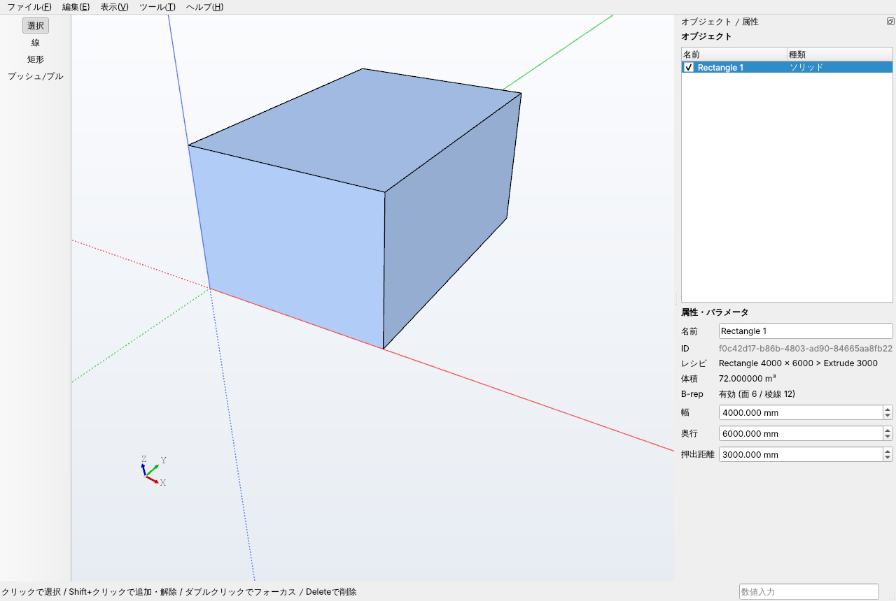

# SketchBRep（仮称）

建築設計向けハイブリッド 3D モデラー。
**操作は SketchUp、形状の本質は Rhino** — 面をクリックして押し出すだけの直接操作で、
内部では B-rep（Open CASCADE）を正規データとして保持します。

> 現在のステータス: **Phase 0〜1 プロトタイプ**（技術成立性の検証 + 操作可能な最小モデラー）



## できること（Phase 0〜1）

- 矩形・線（閉じると面）を描く。原点・端点・中点・エッジ上・面上スナップ、XYZ 軸推論、Shift/矢印キーでの方向ロック
- Push/Pull: 面 → ソリッド押出、ソリッド平面フェースの移動（Boolean + 面統合、失敗時ロールバック）
- 作図中の数値入力（`3000`, `4.5m`, `4000,6000`）と、直後の再入力による寸法変更
- パラメトリック再編集: 矩形の幅/奥行、押出距離、各 Push/Pull 距離を後から変更（レシピを再計算）
- Undo / Redo、ネイティブ保存（`.sbr`、原子的保存 + 検証）、STEP 入出力
- 表示メッシュと正規形状の分離（表示品質を変えても CAD 形状の精度は不変）

## ビルド

依存: C++17 / CMake 3.21+ / Open CASCADE 7.6+ / Qt 6.2+ / nlohmann-json / GoogleTest

### Windows 11（推奨: vcpkg + Visual Studio 2022）

```powershell
git clone https://github.com/microsoft/vcpkg C:\vcpkg
C:\vcpkg\bootstrap-vcpkg.bat
C:\vcpkg\vcpkg install opencascade qtbase nlohmann-json gtest --triplet x64-windows

cmake -S . -B build -G "Visual Studio 17 2022" -A x64 `
      -DCMAKE_TOOLCHAIN_FILE=C:\vcpkg\scripts\buildsystems\vcpkg.cmake
cmake --build build --config Release
ctest --test-dir build -C Release --output-on-failure
build\src\app\Release\SketchBRep.exe
```

（vcpkg の opencascade 初回ビルドには時間がかかります。配布時は `windeployqt` で Qt DLL を同梱してください。）

### Linux（開発・CI 用。Ubuntu 24.04）

```bash
sudo apt install cmake ninja-build g++ libocct-*-dev libtbb-dev qt6-base-dev libgl-dev \
                 nlohmann-json3-dev libgtest-dev xvfb
cmake -S . -B build -G Ninja && cmake --build build
xvfb-run -a ctest --test-dir build --output-on-failure   # GUI テストはディスプレイが必要
./build/src/app/SketchBRep
```

CMake オプション: `SBR_BUILD_APP`（GUI）, `SBR_BUILD_TESTS`, `SBR_BUILD_TOOLS`（すべて既定 ON）。
GUI なしでコアだけ検証する場合は `-DSBR_BUILD_APP=OFF`。

## 使い方

| 操作 | 内容 |
|---|---|
| ホイール / ホイールドラッグ / Shift+ホイールドラッグ | ズーム / オービット / パン |
| ダブルクリック | 選択対象へフォーカス（表示メニューで ON/OFF） |
| F2〜F7 / F8 / Shift+Z | 標準ビュー（アイソメ・平面・正面・右・背面・左）/ 透視⇔平行 / 全体表示 |
| Space / L / R / P | 選択 / 線 / 矩形 / プッシュ/プル |
| 数字を打って Enter | 寸法指定（作図中）・直前の操作の寸法変更（作図後） |
| Shift（押している間） / → ← ↑ / ↓ | 推論方向ロック / X・Y・Z 軸ロック / ロック解除 |
| Esc / Ctrl+Z / Ctrl+Y / Delete | 中止 / 元に戻す / やり直し / 削除 |

**最初の成功体験:** `R` → 原点をクリック → マウスで方向を示して `4000,6000` Enter →
`P` → 面をクリック → 上に動かして `3000` Enter → `Ctrl+S`。
右パネルの「押出距離」を `4500` に変えれば高さが再計算されます。

Phase 0 の CLI 検証: `build/tools/phase0/sbr_phase0 1000 2000 3000 box.step`

## ドキュメント

- [docs/01_feasibility.md](docs/01_feasibility.md) — 技術的成立性・難易度・代替案の分析
- [docs/02_architecture.md](docs/02_architecture.md) — アーキテクチャ・データモデル・ファイル形式
- [docs/03_phase0-1_report.md](docs/03_phase0-1_report.md) — Phase 0〜1 実装報告（確認方法・テスト・既知の制限・次フェーズ課題）

## ライセンスに関する注意

Open CASCADE Technology は LGPL 2.1（+ 例外）、Qt 6 は LGPL 3 / 商用のデュアルライセンスです。
配布形態（動的リンク・再リンク可能性の確保など）は [docs/01_feasibility.md](docs/01_feasibility.md#ライセンス) を参照してください。
