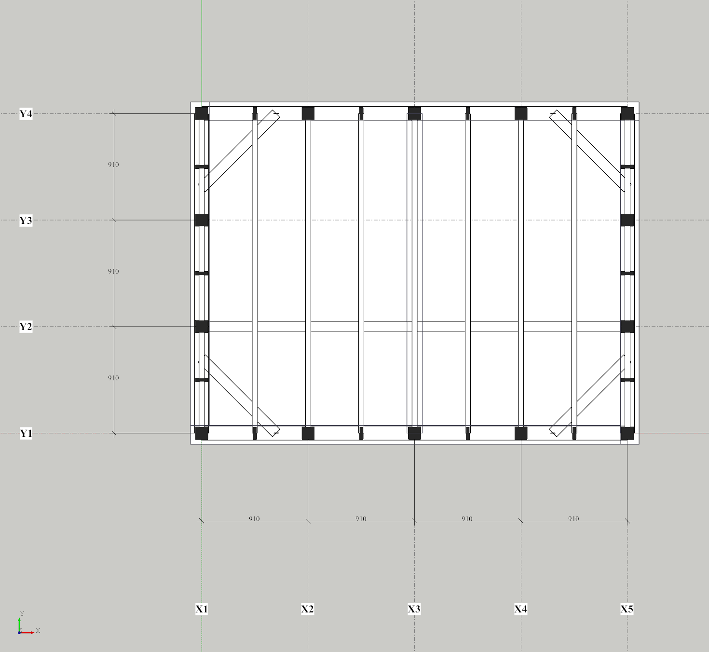

# 平面の切断で、壁の切り口の線を描く（2026-11-07）

木造2階建ての検討モデル（docs/87と同じ、オーナーの非公開データ）を平面図（上から見て切断）で見ると、**外壁の内側の線が消えていた**。

## 原因

平面の切断では、壁を「ふたをしないで」切っている（中の柱・間柱が見えるようにするため）。
そのため、切断の高さには壁の面が何も描かれない。見えていたのは壁の**下端の稜線**だけだった。

- 外壁は土台・床梁の天端（例：1Fは540、2Fは3440）から立っている
- 床の合板の天端（568、3468）はそれより上
- 壁の内側の下端の線は、床の合板の下に隠れる。外側の線は床の外にあるので見えていた

床を張らなければ見えるので、床を張った時だけ消えるように見えていた。

## 直したこと

平面の切断がある時は、見えている壁（属性 `kind=wall`）ごとに、切断面での断面の線を求めて描く。

| 項目 | こうした | 理由 |
|---|---|---|
| 線の求め方 | 壁の形（世界座標）を切断面で切った断面の稜線 | 外側・内側・端部の線が、壁の形のまま正しく出る。層の分かれた壁も同じ |
| 描く高さ | 切断面の1mm下 | 切断面の上の線は、切断で消えるため（開口の記号と同じ） |
| 重なり | 最前面のレイヤー、選択の対象にしない | 床・天井より上に必ず見えるように。線は表示用で、モデルは変わらない |
| 対象 | 切断の高さが壁の高さの範囲内にある、見えている壁 | 隠したタグ・別の階の壁は描かない |

切断を外すと線も消える。壁を足したり消したりすると、描き直す。

（GUIテストの画面。外壁の外側と内側の線、間仕切り壁の線、柱・間柱の切り口が出ている）

## 確かめたこと

- **GUI 自動確認済み**（`tests/test_gui.cpp` の `wallTypeFromToolbarAndColumnsShowInPlanCut` を拡張）
  - 3D表示では線0本。高さ1100で切ると、外壁4枚で8本以上
  - 壁より上（50000）で切ると0本
  - 切断中に壁を1枚足すと、線が増える
  - 切断を外すと0本
- 関係するGUIテスト（`PlanCut`・`Opening`）も成功
- **CI 確認済み**：run 42322468171（Linux・Windows）
- **Windows 実機確認**：まだ（オーナーの検討モデルを平面図で開いて、外壁の内側の線が出るか）

## 配布の記録

| 項目 | 値 |
|---|---|
| コード | `bb7ba82d50e0b6132e342b9feaf4b4d67e0934e6` |
| CI | run 42322468171（push）：Linux・Windows とも成功 |
| ZIP | `SketchBRep-windows-x64-bb7ba82-local.zip`（Codex のチャットフォルダの `outputs\`） |
| サイズ | 70,790,333 bytes |
| SHA256 | `ece24e742a4fca319052793503cb9c03a16704ff4aadc638a23c671e618bd56a` |
| ZIPの検証 | `verify_portable_pads.py`・`verify_portable_mat.py` とも成功（docs/validation/2026-11-07-portable-bb7ba82*.json） |
